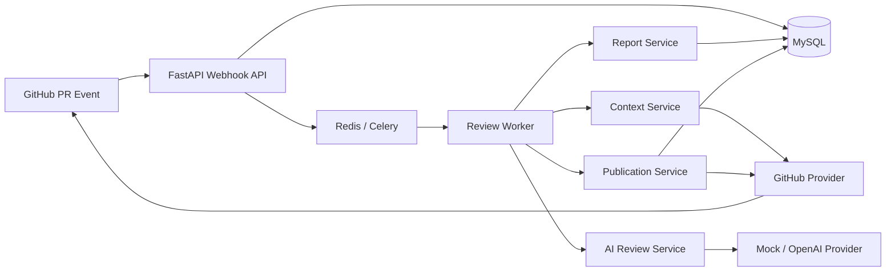

# AgentReview Phase 0～1 实现说明与面试指南

## 1. 文档目的

这份文档描述 AgentReview 当前已经完成的功能、核心设计、代码结构、技术亮点和面试表达方式。

当前结论需要分成两部分理解：

- **代码实现已完成**：Phase 0 工程基础和 Phase 1 最小业务闭环已经写完。
- **真实环境验收未完成**：自动化测试已经通过，但还没有使用真实 GitHub App、真实测试仓库和真实模型 API 完成最终演示。

截至提交 `6a6dbde`，项目有 **144 项自动化测试通过**，Ruff、格式检查、mypy 和 Docker Compose 配置检查均通过。

面试时应当如实描述为：

> 我完成了 AI 代码评审系统 Phase 1 的工程实现和自动化测试，目前正在进行真实 GitHub App 与模型 API 的端到端联调。

不要把尚未完成的真实联调、生产部署和性能压测说成已经完成。

---

## 2. 项目解决什么问题

AgentReview 是一个事件驱动的 GitHub Pull Request 自动审查系统。

当仓库发生 PR `opened`、`synchronize` 或 `reopened` 事件时，GitHub 会向系统发送 Webhook。系统验证请求来源、创建异步审查任务、获取 PR 的代码差异、调用大模型生成结构化审查报告，并将结果发布为 GitHub PR Summary Review。

核心目标不是简单调用一次大模型，而是解决以下工程问题：

- Webhook 可能重复投递，如何避免重复任务。
- Worker 可能超时或崩溃，如何恢复执行。
- GitHub 和模型 API 都可能限流或暂时不可用，如何分类重试。
- AI 分析期间 PR 可能继续 Push，如何避免发布过期结论。
- 模型输出不可信，如何验证它引用的文件和输出结构。
- GitHub 已经发布成功但数据库写入失败，如何避免重试时重复评论。
- API Key、GitHub 私钥和源代码 Diff 如何安全处理。

---

## 3. 当前技术栈

| 分类 | 技术 | 在项目中的用途 |
|---|---|---|
| 语言 | Python 3.12 | 业务逻辑、Worker、Provider 和测试 |
| Web 框架 | FastAPI | Webhook、任务创建、任务查询、健康检查 |
| 数据库 | MySQL 8.4 | 审查任务、文件元数据、报告、Finding 和发布状态 |
| ORM / 迁移 | SQLAlchemy 2、Alembic | 数据访问、约束、事务和数据库版本管理 |
| 消息队列 | Celery、Redis | 异步执行、失败重试和任务解耦 |
| HTTP 客户端 | HTTPX | GitHub REST API 和 OpenAI Responses API |
| 数据校验 | Pydantic | Webhook、GitHub 响应、LLM 输出和配置校验 |
| GitHub 鉴权 | GitHub App JWT、Installation Token | 以最小权限访问安装仓库 |
| 模型接入 | Provider 抽象、Mock Provider、OpenAI Responses Provider | 模型替换、结构化输出和离线测试 |
| 日志 | structlog | Worker 阶段、失败类型和重试信息 |
| 工程质量 | pytest、Ruff、mypy | 自动化测试、格式、Lint 和静态类型检查 |
| 本地部署 | Docker Compose | API、Worker、MySQL、Redis 的统一运行环境 |

项目没有为了匹配某份岗位描述强行使用 Flask、Mafka 或特定内部组件，而是选择更适合个人作品和 Python Agent 岗位的开源技术栈。

---

## 4. 总体架构

项目采用分层架构，并吸收了 DDD 的领域边界思想，但不应在面试中宣称它是完整的 DDD 实现。



各目录职责：

- `app/api`：HTTP 路由和 FastAPI 依赖注入。
- `app/domain`：状态机、领域实体、枚举、过滤规则和领域异常。
- `app/services`：用例编排和事务边界。
- `app/repositories`：数据库访问。
- `app/providers`：GitHub、LLM 等外部系统适配器。
- `app/workers`：Celery 入口、依赖装配和重试策略。
- `app/models`：SQLAlchemy ORM 模型。
- `alembic`：数据库迁移。
- `tests`：单元测试和当前阶段的轻量集成测试。

这种结构的主要价值是：领域逻辑不会直接依赖 FastAPI、Celery、GitHub 或某一家模型厂商。

---

## 5. 一次审查的完整执行流程

### 5.1 Webhook 接收

GitHub 调用：

```text
POST /api/v1/webhooks/github
```

系统首先使用 `GITHUB_WEBHOOK_SECRET` 和原始请求字节验证 `X-Hub-Signature-256`，而不是信任解析后的 JSON。

随后系统检查：

- `X-GitHub-Delivery` 是否存在且长度合法。
- `X-GitHub-Event` 是否存在且受支持。
- PR Action 是否属于 `opened`、`synchronize`、`reopened`。
- Webhook Payload 是否符合 Pydantic Schema。
- Payload 中两个 PR Number 是否一致。

系统只保存 Payload 的 SHA-256 摘要，不保存完整 Webhook 原文。

### 5.2 两级幂等创建任务

数据库使用两个关键唯一约束：

```text
(provider, delivery_id)
(repository, pull_request_number, head_sha)
```

第一层阻止相同 Webhook Delivery 重复处理；第二层阻止不同 Delivery 为同一个 PR Commit 创建重复任务。

并发请求仍可能同时通过应用层查询，因此最终由数据库唯一约束兜底。代码捕获 `IntegrityError`，回滚当前事务，再读取已经存在的记录。

### 5.3 异步投递

API 完成校验和任务落库后立即返回 `202 Accepted`，再由 Redis 将任务交给 Celery Worker。

这样 GitHub Webhook 不需要等待 GitHub API、模型 API 和数据库报告写入全部完成。

### 5.4 获取 PR 上下文

Worker 通过 GitHub App Installation Token 调用 GitHub API：

- 获取 PR 标题、描述、作者、base SHA、head SHA。
- 分页获取全部变更文件。
- 验证分页链接仍然指向配置的 GitHub API Origin，防止恶意跨域分页地址携带 Token。
- 对返回数据执行 Pydantic 校验。
- GitHub 返回 `401` 时使缓存 Token 失效，并且只刷新重试一次。

### 5.5 Diff 过滤

系统不会把所有文件无条件交给模型。当前过滤规则包括：

- 删除文件不审查。
- 没有 Patch 的文件不审查。
- Lock File、生成文件和压缩文件不审查。
- 单文件变更行数超过上限时跳过。
- 单文件 Patch 字符数超过上限时跳过。
- 总 Patch 字符预算超限时跳过后续文件。

每个跳过文件都会记录明确原因，而不是静默丢弃。

数据库只保存路径、变更计数、是否入选、跳过原因和 Patch Digest，不持久化完整源代码 Patch。这减少了敏感代码长期留存在系统数据库中的风险。

### 5.6 AI 结构化审查

`AIReviewService` 不直接依赖 OpenAI，而是依赖 `LLMProvider` 协议。

目前有两个实现：

- `MockLLMProvider`：本地和自动化测试使用，不产生费用。
- `OpenAIResponsesProvider`：调用 Responses API。

Prompt Builder 将 PR 信息和筛选后的 Diff 构造成版本化 Prompt。OpenAI Provider 要求模型按照严格 JSON Schema 返回：

```text
summary
findings[]
  title
  explanation
  suggestion
  file_path
  severity
  category
  confidence
```

模型不负责返回最终 `risk_level`，该字段由服务端根据 Finding 推导后加入领域报告。

模型输出到达业务层后仍需二次验证：

- Finding 的文件必须存在于本次允许审查的文件集合中。
- 文件、标题和解释都相同的重复 Finding 会被拒绝。
- 标题、说明、建议和置信度必须符合约束。
- 总风险等级不直接信任模型，而是由服务端根据最高 Finding Severity 推导。

OpenAI 请求设置 `store=false`，降低模型响应被服务端持久化的范围；应用数据库也不保存 Prompt 和模型原始响应。

### 5.7 报告持久化

系统将最终报告拆成：

- `review_reports`：摘要、风险等级、模型名、Prompt 版本、文件统计、内容摘要。
- `review_findings`：每条问题的路径、标题、解释、建议、分类、严重度和置信度。

每个 Task 只有一个 Report，Finding 通过 `(review_report_id, position)` 保持稳定顺序。

报告使用规范化 JSON 计算 SHA-256 Content Digest。相同内容重复保存时复用原记录；报告变化时替换 Finding，同时保留 Report ID。

### 5.8 发布 GitHub Review

结构化报告由 Markdown Formatter 转成 GitHub Summary Review，内容包括：

- 总风险等级。
- 总结。
- 已审查和跳过文件数。
- 按 `critical → high → medium → low` 排序的 Finding。
- Finding 分类、文件、置信度、原因和修改建议。
- 模型名和 Prompt 版本。

当前固定发布 `COMMENT`，不自动 `APPROVE` 或 `REQUEST_CHANGES`。这样 AI 结论默认是辅助信息，不直接获得合并决策权。

模型生成文本会进行 HTML/Markdown 转义，并通过零宽字符阻止模型内容意外触发 `@username` 通知。超长报告会被确定性截断，但始终保留幂等标记。

### 5.9 发布前 Head SHA 保护

系统在获取上下文时检查一次 PR `head_sha`，在发布前再次请求 GitHub 检查。

如果 AI 分析期间开发者又 Push 了代码：

```text
expected head_sha != current head_sha
```

任务会进入 `STALE`，旧报告不会发布到新版本代码上。

### 5.10 发布幂等和异常恢复

系统在 Review 正文末尾加入隐藏标记：

```html
<!-- agent-review:task=<task-id>:report=<report-digest> -->
```

发布前同时检查：

1. 本地 `review_publications` 是否已经是 `PUBLISHED`。
2. GitHub 是否已有相同 Commit 和隐藏标记的 Review。

这可以处理一个典型的分布式故障：

```text
GitHub 创建 Review 成功
→ Worker 在保存数据库回执前崩溃
→ 消息重新投递
→ 从 GitHub 找到隐藏标记
→ 恢复本地状态，不重复评论
```

这里不能宣称实现了严格的分布式“Exactly Once”。更准确的说法是：

> 系统采用 At-least-once 消息投递，并通过本地唯一约束、步骤级幂等和远程标记对账实现业务去重。

### 5.11 Worker 断点恢复

Celery Worker 重新执行任务时：

- 已经 `COMPLETED`：直接返回。
- `FAILED`、`CANCELLED`、`STALE`：视为终态，不重新处理。
- 已有 Review Report：跳过上下文获取和模型调用，从发布阶段恢复。
- 已经发布：复用发布回执，然后完成任务。

这避免了“报告已经生成，但 Worker 崩溃后再次付费调用模型”的问题。

### 5.12 重试策略

可重试错误包括：

- GitHub 限流和 5xx。
- OpenAI 限流和临时错误。
- 网络连接失败和超时。
- SQLAlchemy `OperationalError`。

不可重试错误包括：

- 配置错误。
- 鉴权或权限错误。
- GitHub 资源不存在。
- 模型输出不合法。
- 业务数据不一致。
- PR Head SHA 已变化。

延迟采用有上限的指数退避和随机抖动，并优先尊重 Provider 的 `Retry-After` 或 GitHub Rate Limit Reset。只有超过最大重试次数后，任务才进入 `FAILED`。

Celery 同时配置：

- `task_acks_late=True`
- `task_reject_on_worker_lost=True`
- `worker_prefetch_multiplier=1`

这些配置使长任务在 Worker 异常退出时更适合重新投递，也避免单个 Worker 预取太多长耗时审查任务。

---

## 6. 数据模型

| 表 | 作用 | 关键约束或字段 |
|---|---|---|
| `review_tasks` | 一次 PR Commit 审查任务 | repository、PR number、head SHA 唯一；status、stage、attempt count |
| `webhook_events` | Webhook 审计与幂等 | provider、delivery ID 唯一；只保存 Payload Digest |
| `review_files` | PR 文件选择结果 | 路径摘要、变更计数、选择状态、跳过原因、Patch Digest |
| `review_reports` | 结构化报告主体 | 每个任务唯一；风险、摘要、模型、Prompt 版本、Content Digest |
| `review_findings` | 结构化问题 | 文件、严重度、分类、置信度、解释和建议 |
| `review_publications` | 外部发布状态 | 每份报告和 Provider 唯一；GitHub Review ID、URL、尝试次数、错误信息 |

任务状态机：

```text
RECEIVED → QUEUED → RUNNING → COMPLETED
                       ├──→ FAILED
                       ├──→ CANCELLED
                       └──→ STALE
```

所有状态变化通过状态机校验，非法变化不会被静默接受。

---

## 7. 安全设计

当前已经实现的安全措施：

1. 使用 HMAC-SHA256 验证 GitHub Webhook 原始请求。
2. 使用 GitHub App 短期 Installation Token，不使用长期个人 Token。
3. Installation Token 有本地缓存、过期缓冲区和线程锁。
4. GitHub App 只申请 `contents: read` 和 `pull_requests: write`。
5. GitHub 分页链接必须保持同源。
6. API Key 和私钥只通过环境变量和只读 Secret 目录进入 Worker。
7. `.env`、`secrets/` 和 `*.pem` 被 Git 忽略。
8. 不在数据库中保存完整 Patch、Prompt、原始 LLM Response 或 API Key。
9. 模型输出经过 Schema、允许文件集合和重复 Finding 校验。
10. 发布内容经过转义、通知抑制和长度限制。

尚未实现的生产级安全能力包括 Secret Manager、密钥轮换、租户级权限模型、Prompt Injection 专项评测和审计后台。

---

## 8. 测试与工程质量

当前测试覆盖的重点包括：

- Webhook 签名正确、错误和缺失场景。
- Webhook Delivery 幂等与并发唯一约束兜底。
- 状态机合法和非法迁移。
- GitHub App JWT、Installation Token 缓存与刷新。
- GitHub API 分页、跨域分页拒绝、401 刷新、错误分类。
- 文件过滤、总 Patch 预算和跳过原因。
- PR 身份与 Head SHA 校验。
- LLM Prompt、严格 Schema、拒绝、限流和错误输出。
- Finding 文件白名单和重复检查。
- Report 与 Finding 的事务性持久化。
- Markdown 排序、转义、截断和隐藏标记。
- GitHub Review 发布、远程对账和失败状态。
- Worker 完整流水线、断点恢复和终态跳过。
- 指数退避、随机抖动、Retry-After 和重试耗尽。

质量命令：

```powershell
ruff check .
ruff format --check .
mypy app
pytest
docker compose config --quiet
```

截至当前版本的结果：

```text
144 passed
Ruff passed
mypy passed
Docker Compose config passed
```

这里的 144 项是自动化测试数量，不代表真实 GitHub、真实模型、性能和并发已经全部验证。

---

## 9. 最值得讲的技术亮点

### 亮点一：不是一次性脚本，而是可恢复的异步流水线

项目将外部事件接收和长耗时 AI 审查拆开。API 快速确认事件，Worker 异步执行；报告落库后即使进程崩溃，也能从发布阶段继续。

这比“Webhook 里直接调用模型”更接近真实服务。

### 亮点二：三个层面的幂等

- Webhook 层：`delivery_id` 唯一。
- 任务层：`repository + PR number + head_sha` 唯一。
- 发布层：本地发布唯一约束 + GitHub 隐藏标记对账。

面试时不要只说“用了 Redis 防重复”，应说明幂等键是什么、数据库如何兜底，以及跨系统调用为什么还需要远程标记。

### 亮点三：避免重复模型费用

Worker 重试时先查询报告。报告已经存在就跳过 AI，直接恢复发布。这同时优化成本和延迟。

### 亮点四：双重 SHA 校验

上下文生成前校验一次，发布前再校验一次，覆盖 AI 调用期间 PR 被更新的竞态窗口。

### 亮点五：模型输出不可信

系统不是看到 JSON 就直接发布，而是：

- Provider Schema 校验。
- 业务层文件白名单校验。
- Finding 去重。
- 风险等级服务端推导。
- Markdown 安全处理。

这是 Agent 项目中很重要的边界意识。

### 亮点六：外部调用不持有数据库长事务

服务先用短事务读取或准备状态，提交后调用 GitHub/LLM，再用短事务保存结果。这样不会因为网络请求持续几十秒而长期占用连接和数据库锁。

### 亮点七：Provider 抽象便于替换模型

业务层只依赖协议。Mock 和 OpenAI 共享同一输出模型，未来可以增加其他模型 Provider，而无需重写审查编排。

### 亮点八：安全与隐私不是最后补丁

短期 Token、Webhook 验签、同源分页、Secret 排除、Diff 不落库、`store=false` 和模型输出转义都在主流程中设计，而不是等上线后再处理。

---

## 10. 面试介绍模板

### 10.1 30 秒版本

> 我做了一个基于 FastAPI、Celery、Redis 和 MySQL 的 GitHub AI 代码评审系统。GitHub PR 事件通过 Webhook 进入系统，Worker 异步获取 Diff，经过文件过滤后调用支持结构化输出的大模型，保存报告并发布 GitHub Summary Review。项目重点不是简单接模型，而是处理了 Webhook 幂等、任务断点恢复、模型输出校验、PR Head SHA 竞态保护、外部 API 分类重试和跨系统发布去重。目前 Phase 1 代码和 144 项自动化测试已经完成，正在做真实 GitHub 与模型联调。

### 10.2 两分钟版本

> 这个项目的目标是把 PR 审查做成一个可靠的异步服务。FastAPI 负责接收 GitHub Webhook，并使用 HMAC 验签。事件会先落 MySQL，再投递到 Redis/Celery，所以 Webhook 不需要等待模型调用。
>
> Worker 会通过 GitHub App 的短期 Installation Token 获取 PR 和分页文件列表，然后按文件类型、变更规模和总 Patch 预算筛选上下文。AI 层通过 Provider 协议解耦模型厂商，OpenAI Provider 使用 Responses API 的严格 JSON Schema；业务层还会检查 Finding 是否引用了本次允许审查的文件，并由服务端推导总风险。
>
> 可靠性上我做了三级幂等：Webhook Delivery、防止同一 Commit 重复建任务，以及发布记录加 GitHub 隐藏标记。Worker 如果在报告保存后崩溃，重试会跳过 AI，避免重复费用。发布前会再次检查 Head SHA，防止把旧代码的报告发到新 Commit。临时错误会按照指数退避和 Retry-After 重试，永久错误直接失败。目前自动化测试有 144 项，下一步是真实 GitHub App 和模型 API 验收。

### 10.3 五分钟展开顺序

如果面试官让你详细介绍，按以下顺序讲：

1. 一句话说明业务目标。
2. 画出 Webhook → Queue → Worker → GitHub/LLM → Database 的流程。
3. 讲为什么异步，而不是在 Webhook 请求中直接调用模型。
4. 讲三级幂等和断点恢复。
5. 讲模型输出校验与风险推导。
6. 讲发布前 Head SHA 二次检查。
7. 讲短事务与分类重试。
8. 讲测试覆盖和当前未完成边界。

不要从“我用了 FastAPI、MySQL、Redis”开始罗列技术名词。先讲问题和流程，再说明每项技术解决了什么问题。

---

## 11. 高频追问与回答

### Q1：为什么选择 Python 和 FastAPI？

> 目标岗位偏 Agent 和后端，Python 的模型生态和工程库更完整。FastAPI 原生支持类型标注和 Pydantic，适合 Webhook Schema、外部 API 响应和模型输出都需要强校验的项目。异步审查本身交给 Celery，所以没有为了追求全异步而让数据库事务和业务代码复杂化。

### Q2：为什么需要 Celery，直接在接口里调用模型不行吗？

> 模型和 GitHub API 都可能耗时、限流或失败。同步执行会让 Webhook 长时间占用连接，并可能导致 GitHub 重试。Celery 让 API 快速返回 `202`，同时提供重新投递和失败重试能力。

### Q3：为什么用 Redis？

> 当前 Redis 主要作为 Celery Broker 和 Result Backend，而不是项目唯一的业务幂等存储。关键幂等仍依靠 MySQL 唯一约束，因为数据库约束比“先查 Redis 再写数据库”更能处理并发竞态。

### Q4：如何保证 Webhook 不重复处理？

> 先按 GitHub Delivery ID 查询，数据库再对 `(provider, delivery_id)` 做唯一约束；此外任务还对 `(repository, pull_request_number, head_sha)` 唯一。应用层查询用于减少冲突，数据库约束负责最终正确性。

### Q5：是否实现 Exactly Once？

> 没有宣称严格 Exactly Once。Celery 是 At-least-once，数据库和 GitHub 也无法共享一个原子事务。我通过步骤级状态、唯一约束、内容摘要和 GitHub 隐藏标记实现业务幂等与异常对账。

### Q6：如何避免 Worker 重试时重复调用模型？

> 模型结果先持久化为 Report。每次执行先查询 Report；如果已经存在，说明 AI 阶段完成，直接从发布阶段恢复。

### Q7：如果分析过程中 PR 又 Push 了怎么办？

> 获取上下文时比较任务 Head SHA，发布前再次获取 PR 比较。第二次检查覆盖模型调用期间的竞态窗口，不一致就标记 `STALE`，不发布旧报告。

### Q8：如果 GitHub 发布成功但数据库失败怎么办？

> Review 正文包含由 Task ID 和 Report Digest 构成的隐藏标记。重试发布前查询 GitHub 已有 Review，找到相同 Commit 和标记后恢复本地发布记录。

### Q9：如何防止模型幻觉？

> 无法保证模型完全不产生错误，但系统限制了输出空间：严格 JSON Schema、Finding 文件白名单、重复检查、字段长度和置信度约束、服务端风险推导。AI 结果暂时只发布为非阻断 COMMENT，不自动批准或阻止合并。

### Q10：为什么不保存完整 Diff？

> 完整 Diff 可能包含公司私有代码。当前只在任务执行过程中使用，数据库保存元数据和 Digest，方便审计是否发生变化，同时降低敏感代码留存风险。生产环境还应增加日志脱敏、数据保留周期和 Secret Manager。

### Q11：为什么报告和发布记录要分表？

> 报告生成和外部发布是两个不同生命周期。AI 成功但 GitHub 失败时，报告仍然有效；独立发布表可以记录尝试次数、外部 ID 和错误，也方便以后支持 GitLab 或多个发布目标。

### Q12：为什么只发 Summary Review，不做行级评论？

> Phase 1 先验证最小闭环。行级评论需要把 Diff 的新旧行号、Side、Position 和多文件 Patch 精确映射，错误发布的风险更高，所以放在 Phase 2 单独实现和测试。

### Q13：系统如何支持更换模型？

> `AIReviewService` 依赖 `LLMProvider` 协议，不依赖具体厂商。Provider 负责厂商请求和响应解析，业务层统一接收结构化输出。增加其他厂商时实现同一协议即可。

### Q14：当前最大的性能瓶颈是什么？

> Phase 1 的主要耗时会是 GitHub 网络请求和单次 LLM 推理，而不是 FastAPI。当前先做了异步化、上下文预算和断点恢复；还没有进行真实压测，也没有实现分片并行 Agent，所以不能给出虚构的响应时间优化数字。

### Q15：这是完整 DDD 吗？

> 不是。我使用了领域实体、状态机、Repository、Provider 和应用服务来隔离业务规则与基础设施，可以称为 DDD-inspired 分层设计，但没有为了形式引入聚合、领域事件总线等全部 DDD 模式。

### Q16：为什么没有直接使用 LangChain？

> Phase 1 只有一个结构化模型调用，自建轻量 Provider 更容易理解请求、重试、Schema 和错误边界，也减少框架耦合。后续真正出现多 Agent 编排、工具调用和状态图需求时，再评估是否引入专门框架。

---

## 12. 简历写法

可以写成以下三到四条：

- 基于 FastAPI、Celery、Redis 和 MySQL 构建事件驱动的 GitHub PR 自动评审服务，实现 Webhook 验签、异步 Diff 获取、结构化 AI 审查、报告持久化和 Summary Review 发布闭环。
- 设计 Delivery、PR Commit 和 Review Publication 三级幂等机制，通过数据库唯一约束与 GitHub 隐藏标记对账，支持 At-least-once 投递下的异常恢复和重复发布抑制。
- 构建可替换的 LLM Provider 与严格 JSON Schema 输出链路，增加 Finding 文件白名单、重复检测、风险等级推导和 Markdown 安全处理，降低模型幻觉进入外部系统的风险。
- 实现 Head SHA 双重校验、步骤级断点恢复、外部 API 错误分类及指数退避重试；完成 144 项自动化测试并通过 Ruff、mypy 和 Compose 配置检查。

不要写以下尚未验证的内容：

- “响应时间从 30 秒降低到 10 秒”。
- “支持大规模 Agent 并行调度”。
- “Redis 热点缓存将响应降低到 1 秒”。
- “生产环境支持多租户隔离”。
- “已在企业仓库大规模上线”。

这些属于原始项目简介或后续规划，不是当前仓库已经实现并验证的事实。

---

## 13. 演示建议

正式面试前准备一个专门的 GitHub 演示仓库。

### 第一轮：真实 GitHub + Mock LLM

1. 启动 MySQL、Redis、API 和 Worker。
2. 在 GitHub App 中配置 Webhook 和最小权限。
3. 保持 `LLM_PROVIDER=mock`。
4. 新建 PR。
5. 展示 Webhook Delivery 成功。
6. 展示 Worker 日志中的阶段变化。
7. 展示 PR 中的 AgentReview Summary。
8. 展示任务最终状态和数据库发布记录。

这一轮验证基础设施和 GitHub 闭环，不产生模型费用。

### 第二轮：真实 GitHub + 真实模型

1. 配置模型、API Key 和 `LLM_PROVIDER=openai`。
2. 提交一个小而明确的缺陷，例如遗漏空值处理或权限判断。
3. 创建新 Commit，触发新的 Head SHA 任务。
4. 展示结构化 Finding、风险等级和修改建议。
5. 确认日志和数据库没有 API Key、完整 Prompt 或 Patch。

### 建议准备的异常演示

- 重启 Worker 后再次处理已有报告，展示 AI 不会重复调用。
- 在审查期间 Push 新 Commit，展示旧任务进入 `STALE`。
- 模拟 GitHub 5xx，展示任务进入重试而不是立即失败。

演示前必须自己完整走一遍流程，避免在面试现场第一次测试外部服务。

---

## 14. 当前边界与下一阶段

当前尚未完成：

- 真实 GitHub App、MySQL、Redis、Celery 的完整联调验收。
- 真实模型 API 输出兼容性和费用测试。
- Diff 行号映射与行级评论。
- 多 Worker 并发抢占租约。
- 同一 PR 不同 Commit 任务的统一调度和旧任务主动取消。
- Token 精确计数、按文件分片和并行 Agent。
- Redis 缓存、租户配额和限流。
- 指标监控、Tracing、管理后台和部署流水线。
- Prompt Injection 和离线质量评测。

Phase 2 最适合优先完成：

1. Diff 新旧行映射。
2. 行级 Review Comment。
3. Worker 租约与并发抢占保护。
4. 同一 PR 新 Commit 到达后的旧任务治理。
5. 真实集成测试和故障注入。

---

## 15. 最后需要记住的表达原则

面试时围绕四个词展开：

```text
异步、幂等、可信边界、故障恢复
```

这个项目真正有价值的地方不是“调用了一个 AI API”，而是：

> 把不稳定、昂贵且输出不完全可信的模型调用，放进一个有状态、有校验、有重试、有版本保护、能恢复的后端工作流中。

这也是它同时适合 Agent 岗位和后端岗位的原因。

## 参考资料

- [GitHub Webhooks](https://docs.github.com/en/apps/creating-github-apps/registering-a-github-app/using-webhooks-with-github-apps)
- [GitHub App permissions](https://docs.github.com/en/apps/creating-github-apps/registering-a-github-app/choosing-permissions-for-a-github-app)
- [GitHub Pull Request Reviews API](https://docs.github.com/en/rest/pulls/reviews)
- [OpenAI Responses API](https://developers.openai.com/api/reference/cli/resources/responses/methods/create)
- [OpenAI API quickstart](https://platform.openai.com/docs/quickstart/make-your-first-api-request)
