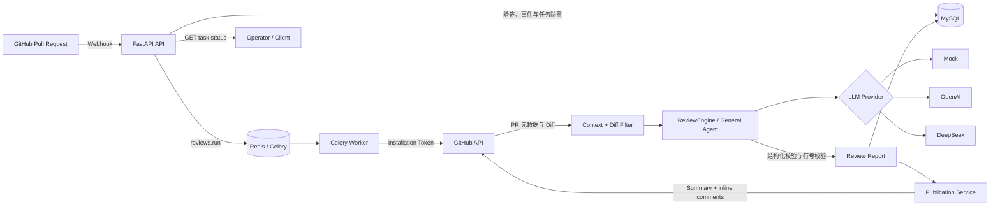
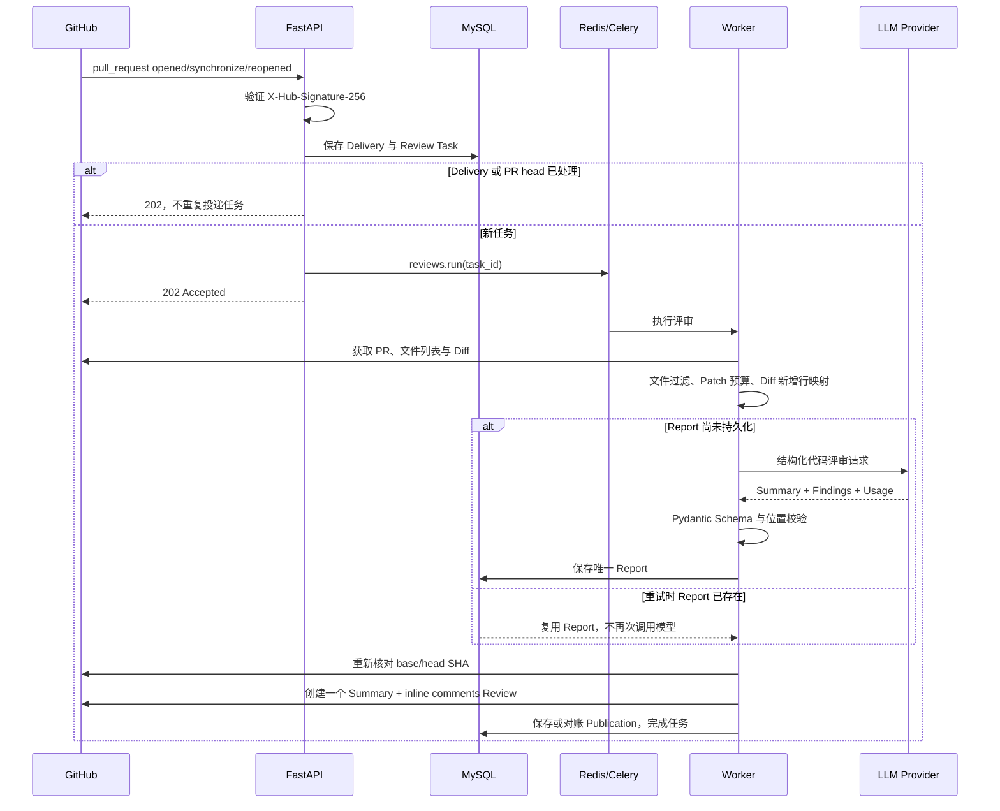

# AgentReview

[](https://github.com/lxr0111/agent-review/actions/workflows/ci.yml)

AgentReview 是一个面向 GitHub Pull Request 的 AI 代码评审系统。它以 GitHub App
接收 PR 事件，通过 FastAPI、Celery、Redis 和 MySQL 执行异步评审，调用可替换的
LLM Provider 生成结构化问题，再将 Summary 与可定位的行级评论发布回 GitHub。

这个项目关注的不只是“调用一次模型”，还覆盖 Webhook 验签、业务幂等、任务重试、
阶段级恢复、结构化输出、Diff 行号校验、发布对账，以及可复现的模型与架构评测。

## 已实现能力

- **端到端异步评审**：GitHub Webhook → FastAPI → Celery Worker → GitHub Diff →
  LLM Review → MySQL Report → GitHub Review。
- **安全的 GitHub App 接入**：使用短期 Installation Token，不依赖长期 Personal
  Access Token；Webhook 使用 HMAC-SHA256 验签。
- **结构化模型输出**：Provider 统一返回 Pydantic 校验后的 Summary、Finding、严重程度、
  分类、置信度和可选代码位置。
- **行级评论与安全降级**：仅接受 Unified Diff 中真实存在的新增行；无法可靠定位时，
  Finding 仍保留在 Summary 中，不猜测行号。
- **业务结果幂等**：Delivery ID、`repository + PR number + head SHA`、Report 和
  Publication 均有应用层检查与数据库唯一约束兜底。
- **重试与断点恢复**：Timeout、429、5xx 和临时数据库故障采用有界指数退避；支持
  `Retry-After`；Report 已持久化时，重试不会再次调用模型或重新获取 Diff。
- **发布前一致性检查**：发布前重新核对 PR base/head SHA，过期结果进入 `stale`，不会
  评论到错误的提交。
- **可替换 LLM Provider**：当前支持 Mock、OpenAI Responses API 和 DeepSeek
  Responses API；业务 Pipeline 不依赖具体厂商。
- **离线评测与架构实验**：版本化 Dataset、Matcher、Prompt 和实验工件，统计 Recall、
  Precision、F1、误报、Schema、Token 与延迟，并支持 General、专业 Agent 和 Planned
  Multi-Agent 的同条件对照。
- **持续集成**：GitHub Actions 自动执行 Ruff、mypy、全量 pytest，以及 MySQL 8.4
  Migration 的 `head → base → head` 往返验证。

## 系统架构



生产链路当前使用一个 General Agent。专业 Agent、确定性 Planner、Validator 和
Aggregator 已作为 Eval-first 实验能力实现，但真实对照没有证明多 Agent 相对 General
有稳定的净质量收益，因此没有为了架构复杂度而接入生产路径。

## 一次 PR 评审的时序



## 核心设计取舍

### 1. 保证业务幂等，不声称 LLM Exactly Once

系统能保证同一个 Delivery、同一个 PR Head 和同一份 Report 不产生重复的业务结果。
但如果模型请求已经被服务端处理，而客户端在收到响应前超时，模型调用和费用理论上仍
可能重复。因此项目明确表述为“业务结果幂等”，而不是无法证明的 Exactly Once。

### 2. Report 与 Publication 分阶段持久化

模型评审完成后先保存 Report，再执行 GitHub Publication。如果发布阶段失败，Celery
重试会复用已有 Report，只恢复发布阶段。Publication 还会通过稳定隐藏标记与 GitHub
远端 Review 对账，处理“远端成功、本地回执保存失败”的窗口。

### 3. 模型不能直接决定评论位置

Prompt 可以返回新文件行号，但服务端会重新解析 Unified Diff，确认范围内每一行都是
Patch 中的新增行。删除行、上下文行、越界位置或不连续范围会被降级为 Summary，避免
把评论发布到错误位置。

### 4. 用评测决定是否采用多 Agent

项目实现了专业 Agent 路由与聚合实验，但在两版冻结 Security Holdout 上，Planned
Multi-Agent 没有超过 General 的质量，同时消耗更多 Token、带来更高延迟。因此当前
生产架构保持单 General Agent，实验组件保留在离线评测路径中继续演进。

## 技术栈

| 层次 | 技术 |
|---|---|
| API | Python 3.12、FastAPI、Pydantic |
| 异步任务 | Celery、Redis |
| 数据与迁移 | MySQL 8.4、SQLAlchemy 2、Alembic |
| 外部集成 | GitHub App、GitHub REST API |
| AI | Provider Protocol、OpenAI / DeepSeek Responses API、Mock Provider |
| 质量保障 | pytest、Ruff、mypy、GitHub Actions |
| 本地部署 | Docker Compose、Conda（可选） |

## 快速启动

### 环境要求

- Python `3.12`
- Docker Desktop 与 Docker Compose
- Conda（可选，便于本地隔离 Python 环境）

### 1. 创建本地 Python 环境

使用仓库提供的 Conda 定义：

```powershell
conda env create -f environment.yml
conda activate agent-review
```

如果环境已经存在：

```powershell
conda activate agent-review
python -m pip install -e ".[dev]"
```

### 2. 创建本地配置

```powershell
Copy-Item .env.example .env
```

默认 `LLM_PROVIDER=mock`，不会调用付费模型。`.env`、`secrets/`、PEM 私钥和 API Key
均不得提交到版本控制。

### 3. 启动服务

```powershell
docker compose up -d --build
docker compose ps
```

Compose 会启动：

- API：<http://localhost:8000>
- Swagger UI：<http://localhost:8000/docs>
- MySQL：宿主机端口 `3307`
- Redis：宿主机端口 `6379`
- Celery Worker

### 4. 检查基础设施

```powershell
Invoke-RestMethod http://localhost:8000/health/live
Invoke-RestMethod http://localhost:8000/health/ready | ConvertTo-Json -Depth 3
docker compose exec api alembic current
docker compose exec worker celery -A app.workers.celery_app:celery_app inspect ping
```

预期 readiness 中 `database` 和 `redis` 均为 `ok`，Alembic 位于当前 head，Worker 返回
`pong`。

停止服务：

```powershell
docker compose down
```

该命令默认保留 MySQL Volume；只有明确需要清空本地数据库时才使用 `docker compose down -v`。

## 配置真实 GitHub App

建议只安装到专用测试仓库。

1. 创建 GitHub App，并配置权限：
   - Repository contents：`Read-only`
   - Pull requests：`Read & write`
2. 订阅 `Pull request` 事件。
3. 将 Webhook URL 指向公网可访问的
   `https://<your-tunnel-domain>/api/v1/webhooks/github`。
4. 在 GitHub App 与本地 `.env` 中配置同一个随机 Webhook Secret。
5. 生成 GitHub App Private Key，将 PEM 放入本地 `secrets/`，不要提交。
6. 在 `.env` 中配置以下变量名对应的真实值：

```text
GITHUB_WEBHOOK_SECRET=...
GITHUB_APP_CLIENT_ID=...
GITHUB_PRIVATE_KEY_PATH=secrets/your-github-app-key.pem
```

选择真实模型时，再配置 Provider：

```text
LLM_PROVIDER=deepseek
LLM_BASE_URL=https://api.deepseek.com/
LLM_MODEL=<a Responses API compatible model>
LLM_API_KEY=...
```

重新创建 API 与 Worker，使环境变量生效：

```powershell
docker compose up -d --build --force-recreate api worker
docker compose logs -f api worker
```

在测试仓库创建或更新 PR 后，应观察到：Webhook 返回 `202`、Worker 完成 Pipeline、PR
出现 `AgentReview summary`，有合法位置的 Finding 以 inline comment 发布，其余 Finding
保留在 Summary 中。

## 主要配置项

| 配置 | 用途 | 默认/说明 |
|---|---|---|
| `DATABASE_URL` | SQLAlchemy 数据库连接 | 本地默认连接 `localhost:3307` |
| `REDIS_URL` | Redis 健康检查连接 | DB 0 |
| `CELERY_BROKER_URL` | Celery Broker | Redis DB 1 |
| `CELERY_RESULT_BACKEND` | Celery Result Backend | Redis DB 2 |
| `REVIEW_WORKER_MAX_RETRIES` | Worker 最大重试次数 | `3` |
| `REVIEW_RETRY_BASE_SECONDS` | 指数退避初始秒数 | `5` |
| `REVIEW_RETRY_MAX_SECONDS` | 退避上限 | `300` |
| `GITHUB_WEBHOOK_SECRET` | Webhook HMAC Secret | 真实联调必填 |
| `GITHUB_APP_CLIENT_ID` | GitHub App Client ID | 真实联调必填 |
| `GITHUB_PRIVATE_KEY_PATH` | GitHub App PEM 路径 | 真实联调必填 |
| `LLM_PROVIDER` | `mock` / `openai` / `deepseek` | 默认 `mock` |
| `LLM_MODEL` | Provider 模型名 | 真实模型必填 |
| `LLM_BASE_URL` | Responses API Base URL | 可选，Provider 有默认值 |
| `LLM_API_KEY` | Provider API Key | 真实模型必填 |
| `LLM_TIMEOUT_SECONDS` | 模型请求超时 | `60` |
| `LLM_MAX_OUTPUT_TOKENS` | 最大输出 Token | `4096` |

完整模板见 [.env.example](.env.example)。

## API

| 方法 | 路径 | 说明 |
|---|---|---|
| `GET` | `/health/live` | 进程存活检查 |
| `GET` | `/health/ready` | MySQL 与 Redis readiness |
| `POST` | `/api/v1/webhooks/github` | GitHub App Webhook 入口 |
| `POST` | `/api/v1/reviews` | 创建 Review Task |
| `GET` | `/api/v1/reviews/{task_id}` | 查询阶段、尝试次数和终态 |

## 测试与静态检查

```powershell
python -m ruff check .
python -m ruff format --check .
python -m mypy app evals scripts/llm_fault_stub.py
python -m pytest
git diff --check
```

自动化测试默认使用 Mock 或受控 HTTP Stub，不会访问 GitHub，也不会调用付费模型。

当前已验证基线：

- `344 passed`；
- Ruff lint / format 通过；
- mypy strict 检查 `102` 个源文件通过；
- MySQL 8.4 空 Schema 的 `base → head → base → head` Migration 往返通过；
- GitHub Actions 的静态检查、测试和 Migration 两个 Job 均已在远端 Runner 通过。

## 评测框架

默认命令只运行离线 Mock evaluator self-test，不访问网络、数据库或 GitHub：

```powershell
python -m evals.runner
```

真实 DeepSeek 评测必须同时显式指定 Provider 与 `--live`。例如低成本单案例试跑：

```powershell
python -m evals.runner --provider deepseek --live --max-cases 1
```

该命令会产生真实 API 调用和费用；自动化测试不会执行它。完整 Dataset、Baseline、离线比较、
精确 Case、专业 Agent 和多 Agent 实验命令见 [evals/README.md](evals/README.md)。

评测数字应理解为固定模型、Prompt、Dataset SHA 和 Git Commit 下的回归证据，不能外推为
所有真实仓库的生产准确率。

## 验证证据与边界

项目已经完成以下真实或受控联调：

- GitHub App Webhook → FastAPI → Celery → DeepSeek → GitHub Review 真实端到端链路；
- 单行与多行 inline comment 发布；
- 同一 Delivery Redelivery 不重复创建任务、调用模型或发布 Review；
- Timeout、429、500/503 的恢复，`Retry-After` 与指数退避；
- 401 与非法结构化输出快速失败；
- Report 已保存后的 Publication 独立恢复；
- 无合法位置 Finding 的 Summary-only 降级；
- 两版冻结 Security Holdout 的三架构真实对照。

明确边界：

- 生产路径目前不是多 Agent；
- 不承诺 LLM 调用 Exactly Once；
- 评测集规模仍小，不代表所有语言和仓库；
- 尚未给出生产级吞吐量或 P95 性能承诺；
- 自动化 Review 只发布非阻塞 `COMMENT`，不自动 Approve，也不控制合并。

## 项目结构

```text
app/
├── api/           # FastAPI 路由与依赖装配
├── core/          # 配置、日志、安全和统一异常
├── domain/        # 状态机、Report、Diff 与领域规则
├── models/        # SQLAlchemy ORM
├── providers/     # GitHub、LLM 和外部传输适配器
├── repositories/  # 持久化访问
├── services/      # Pipeline、Agent、评测相关应用服务
└── workers/       # Celery 任务、重试策略与工厂
alembic/           # MySQL Migration
evals/             # Dataset、Matcher、Metrics、Baseline 与架构对照
scripts/           # 基础设施等待、故障注入和只读检查脚本
tests/             # 单元测试及测试骨架
```

## 延伸文档

- [PROJECT_EVOLUTION_AND_INTERVIEW_GUIDE.md](PROJECT_EVOLUTION_AND_INTERVIEW_GUIDE.md)：
  完整演进记录、验证证据、面试讲法与限制。
- [PHASE1_IMPLEMENTATION_AND_INTERVIEW_GUIDE.md](PHASE1_IMPLEMENTATION_AND_INTERVIEW_GUIDE.md)：
  Phase 0–1 架构与实现讲解。
- [FAULT_INJECTION_GUIDE.md](FAULT_INJECTION_GUIDE.md)：受控故障注入与恢复验证。
- [MULTI_AGENT_READINESS_AND_DESIGN.md](MULTI_AGENT_READINESS_AND_DESIGN.md)：多 Agent
  设计、接入条件与实验原则。
- [PROJECT_PLAN.md](PROJECT_PLAN.md)：项目目标与阶段规划。

## 后续方向

- 扩充多语言、复杂 Diff 和真实 PR 评测集；
- 大型 PR 分片、并发调度、全局限流与 Token 预算控制；
- Prompt Injection 专项评测；
- 自动化回归阈值与质量门禁；
- 指标、Tracing 和可观测性 Dashboard；
- 在新证据证明有净收益后，再评估是否将专业 Agent 接入生产。
